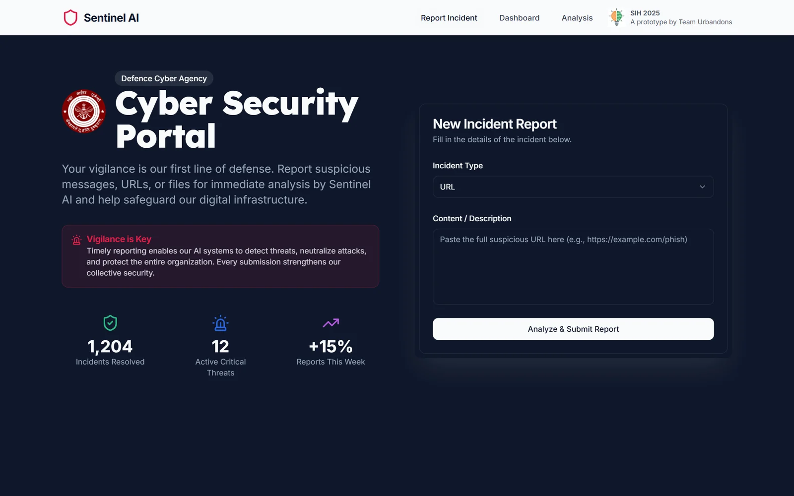
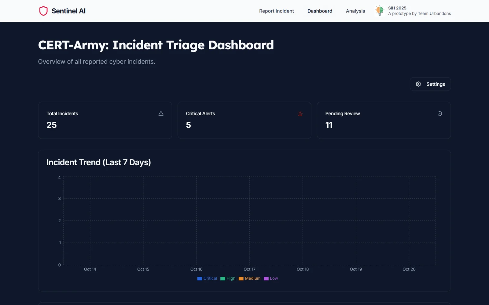
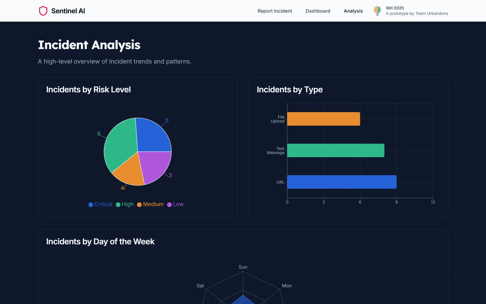
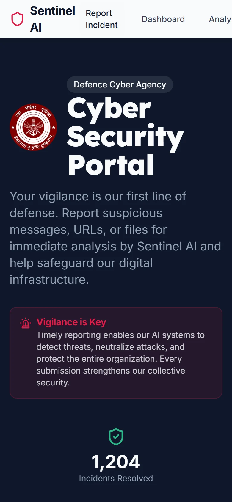

<div align="center">


**Defence personnel report a suspicious URL, message or file; Sentinel assigns a risk level and mitigation steps; CERT-Army triages everything on one dashboard.**

[Live demo](https://cybersecurity-phi.vercel.app) · SIH 2025 prototype by Team Urbandons



</div>

## Screens

<table>
  <tr>
    <td width="50%"></td>
    <td width="50%"></td>
  </tr>
  <tr>
    <td><b>CERT-Army triage dashboard.</b> Total incidents, critical alerts, pending reviews and a 7-day incident trend.</td>
    <td><b>Incident analysis.</b> Incidents by risk level, by type and by day of the week.</td>
  </tr>
</table>

<p align="center"></p>

## How it works

1. **Submit.** Pick the incident type (URL, text or file) and paste the content.
2. **Assess.** The content is given a risk level of Low, Medium, High or Critical, a summary and mitigation steps for that level.
3. **AI flows.** Two Genkit flows on Gemini 2.5 Flash (`src/ai/flows`) summarise a report and suggest mitigation steps. For a stable demo, the submission path currently uses a keyword-based mock analysis instead (`src/app/actions.ts`).
4. **Confirm.** The submission page shows the details, the colour-coded risk level and the recommended actions.
5. **Triage.** CERT-Army sees every incident on the dashboard and can open each one in detail.

## Tech stack

Next.js 15, React, TypeScript, Tailwind CSS, shadcn/ui, Recharts, Genkit with Google AI (Gemini).

## Run locally

```bash
npm install
npm run dev              # http://localhost:9002
```

For the AI flows, set `GEMINI_API_KEY` (or `GOOGLE_API_KEY`) in `.env`.

## Routes

| Route | Page |
|---|---|
| `/` | Report an incident |
| `/submission/[id]` | Submission confirmation with risk level and actions |
| `/dashboard` | CERT-Army triage dashboard |
| `/analysis` | Incident analysis charts |
| `/incidents/[id]` | Incident details |

Design notes: [docs/blueprint.md](docs/blueprint.md).
